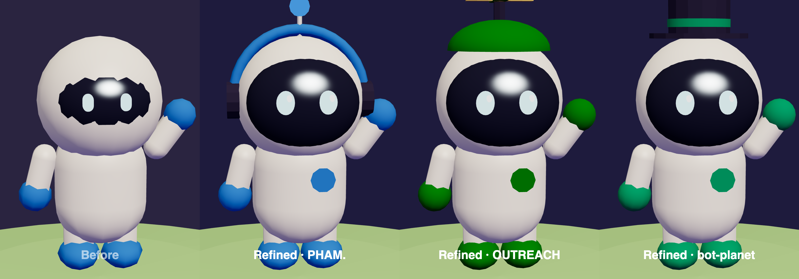

# 🪐 Bot Planet

A cozy low-poly planet that lives in your MacBook's camera notch. Hover the notch and a black island drops down: every Claude agent you work with is a little astronaut on it.



## What you see

- **Astronauts:** one per Claude Code session (live, through hooks) and per Cowork session. Each project has its own suit colour and hat.
- **Live status:**
  - Working agents do a job that matches their tool: 🔨 building (Edit/Write), 💻 terminal (Bash), 📡 dish (web/MCP), 🔍 exploring (Read/Grep), 📋 planning.
  - Agents that need you wave, and the notch peeks out ("👋 *name* needs you").
  - Finished agents walk back to camp and sit by the fire.
- **Who's busy:** busy astronauts wear a name plate at their feet. Tap "N busy" in the notch row for the full list.
- **Continents:** one country per project, coloured, sized by your last ~60 days of use. Projects idle for 60+ days vanish.
- **Village and landmarks:** each project has a house that grows with your work, plus a themed landmark (lighthouse, print shop, server tower, vault, windmill).
- **Satellites:** your scheduled Claude routines orbit the planet with a countdown to their next run, and beam to their project while running.
- **Logbook:** click a house for per-project stats; the weekly recap shows tasks done, Claude's hours, your reply time and tokens written.
- **Postcard:** a top-down group photo of the whole crew posing, with the week's numbers, saved to Downloads.
- **Little touches:** blinking, idle dances, speech bubbles showing the current file or command, a notch ticker, flowers when you click the ground, and astronauts that look up when you come close.

## Run

```bash
npm install
npm start                               # dev: the notch app (hosts the hook server on :4711)
node scripts/package.mjs --install      # build Bot Planet.app and copy it to /Applications
npm run serve                           # server only → http://localhost:4711
```

`?demo` forces the demo crew. `?notch&mb=32&nw=185` previews the notch in a browser. `?debug` exposes `window.__bp`.

## Connect Claude Code

```bash
npm run install-hooks                       # backs up ~/.claude/settings.json first
node scripts/install-hooks.mjs --uninstall
```

Hooks are fire-and-forget (`curl -m 1 … || true`): if the app isn't running, Claude carries on as normal.

## Data sources and their limits

| Source | What it gives |
| --- | --- |
| Claude Code hooks | Live status, tools, subagents, permission prompts |
| `~/.claude/projects/*.jsonl` | History: village, logbook, continent sizes |
| Cowork `remote-session-spaces.json` | Cowork sessions per project; no live status (use "Working on it" on the card) |
| `routines.json` snapshot | Scheduled cloud routines; refresh with `scripts/routines-snapshot.mjs` |

Battery: nothing renders while the notch is collapsed, and it runs at 30fps when open.

`docs/CONTRACT.md` describes how the server, the Electron shell and the renderer fit together.
